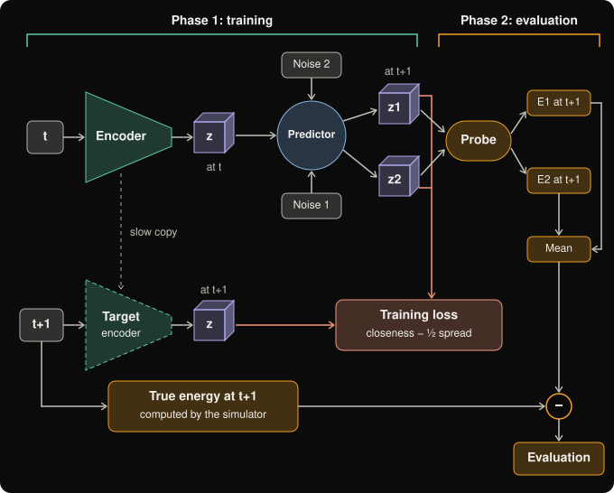

# weather-world-model

[](https://github.com/gabrielkpo/weather-world-model/actions/workflows/ci.yml) [](LICENSE)

Probing what a latent world model has learned about atmospheric physics, by reading its latent space with dynamical-systems tools, in three steps of increasing realism.

> **Status:** step 1 of 3 done (Lorenz-96 proof of concept), step 2 (quasi-geostrophic wind world) in progress. See the [roadmap](#status-and-roadmap). Expect breaking changes.

## Why

Latent world models, in the line of JEPA and V-JEPA 2, predict how the world evolves in a space of abstract representations rather than in pixels, and they are starting to reach weather and climate. Most work reports forecast quality; a complementary question is what such a model has learned about the physics. Probes and surprise on impossible events are well studied; this project examines other properties of the latent space:

- **Predictability**: do nearby latent trajectories diverge the way chaotic weather does? AI weather models are known to reproduce fast initial error growth poorly.
- **Arrow of time**: does the latent space encode that atmospheric evolution is irreversible?
- **Physical readouts**: can energy, jet speed or vortex strength be read linearly from the latent, where the simulator gives the exact answer?

## How it works

```mermaid
flowchart LR
    subgraph S1[Step 1: proof of concept]
        L96[Lorenz-96] --> JS1[small JEPA]
    end
    subgraph S2[Step 2: wind world]
        QG[two-layer quasi-geostrophic atmosphere] --> JS2[small JEPA, one-step and multi-step]
        QG --> VJ2[V-JEPA 2 on wind video]
    end
    subgraph S3[Step 3: real weather]
        SEVIR[SEVIR radar] --> VJ3[V-JEPA 2 adapted]
    end
    JS1 --> D[Diagnostics: predictability, arrow of time, readouts]
    JS2 --> D
    VJ2 --> D
    VJ3 --> D
    D --> TRUTH[Exact answers from the simulators]
    D --> NOAA[NOAA Storm Events reports]
```



1. **Proof of concept.** The diagnostics are first run on Lorenz-96, a chaotic system with an exactly computable Lyapunov exponent, to show they recover known answers.
2. **Wind world.** A two-layer quasi-geostrophic atmosphere (a baroclinic jet with cyclones and anticyclones) gives a 2D world whose physics is fully known. World models are trained on it, with a one-step and a multi-step latent loss, and their latent space is read against the simulator's exact energy, jet speed and vortices.
3. **Real weather.** V-JEPA 2 (MIT) is adapted to SEVIR radar videos of real storms with its own self-supervised objective, and the same diagnostics are confronted with severe storms reported in NOAA Storm Events.

### The model and how it is examined



The figure shows the stochastic variant; the deterministic model has no noise input and makes a single prediction.

| Term | Meaning |
|---|---|
| `t`, `t+1` | Wind maps at two consecutive instants. |
| Encoder | A convolutional network that compresses a map into `z`. |
| `z` | The latent state, 32 numbers. |
| Target encoder | A slow copy of the encoder that provides the training target; it is never updated by gradients. |
| Predictor | Advances `z` by one time step; the only part that moves time forward. |
| Noise 1, Noise 2 | Random vectors; different draws give different possible futures. |
| `z1`, `z2` | Two possible latent states at `t+1`. |
| Training loss | How close `z1` and `z2` are to the target, minus half the distance between them (energy score); it updates the encoder and the predictor. |
| Probe | A linear formula fitted after training, on the frozen model, that reads a physical quantity from `z`. |
| `E1`, `E2` | The energy read by the probe in each scenario. |
| True energy | Computed by the simulator on the true map at `t+1`; the model never sees it during training. |
| Evaluation | Compares the mean probe reading with the true energy (R²). |

Technical choices and their trade-offs:

- **A pretrained world model rather than training a large one,** because three weeks on a free GPU cannot match V-JEPA 2's pretraining; the cost is a domain gap (natural RGB video vs physical fields), measured with a small model.
- **Two simulated worlds before real data,** because real weather has no ground-truth Lyapunov exponent or energy budget; the cost is time spent before the radar.
- **Linear readouts,** because a linear probe shows what the latent makes explicit; the cost is missing information stored nonlinearly.

## Evaluation plan

The full protocol, frozen before any measurement and amended only through dated entries, is in [docs/PROTOCOL.md](docs/PROTOCOL.md). In short:

| Step | Hypothesis | Success criterion |
|---|---|---|
| 1 | The diagnostics recover known answers | Lyapunov exponent within 30 %, arrow-of-time probe > 80 % on Lorenz-96 and < 60 % on a reversible oscillator |
| 2 | Multi-step training restores chaotic error growth | latent growth rate within 30 % of the simulator's own |
| 2 | Physical quantities are linearly readable | test R² ≥ 0.7 for energy, enstrophy and jet speed, ≥ 0.1 above random weights |
| 2 | The arrow of time is readable, and pretraining helps | probe > 80 %; V-JEPA 2 ≥ 0.05 above the small JEPA |
| 3 | Severe storms are less predictable in latent space | shorter horizon than ordinary storms, Mann-Whitney p < 0.05 |

Splits are by run or by date, tuning uses the validation split only, every number comes from a versioned run record, and negative results are reported.

## Results so far

Calibration on simulated systems with known answers (3 seeds, details and caveats in [docs/RESULTS.md](docs/RESULTS.md)):

| Diagnostic | On the true system | On the small JEPA | Verdict |
|---|---|---|---|
| A. Predictability (Lorenz-96 Lyapunov exponent ≈ 1.69) | 1.70 to 1.74 | −0.03 to 0.13 | not supported: the learned latent dynamics do not diverge |
| B. Growth and decay modes (linear map) | exact | moduli within 7.4 %, but the growing mode comes out damped | supported, with a caveat |
| C. Arrow of time (irreversible vs reversible) | 100 % vs 49 to 52 % | 91 to 95 % vs 51 to 52 % | supported |

The diagnostic code recovers the known answers; the small world model keeps the arrow of time but loses chaotic error growth. The modes diagnostic was withdrawn afterwards (protocol amendment 2).

## Status and roadmap

| Step | Content | State |
|---|---|---|
| 0 | Repository foundation, protocol | done |
| 1 | Lorenz-96 proof of concept, calibrated diagnostics | done, see [results](docs/RESULTS.md) |
| 2 | Quasi-geostrophic wind world: simulator, small JEPA (one-step and multi-step), V-JEPA 2, predictability, arrow of time, readouts | in progress |
| 3 | SEVIR radar with NOAA Storm Events, adapted V-JEPA 2 | planned |
| 4 | Results, report | planned |

## Run it

Requires [uv](https://docs.astral.sh/uv/). The calibration runs on a laptop CPU in about two minutes and downloads only Python dependencies.

```bash
git clone https://github.com/gabrielkpo/weather-world-model.git && cd weather-world-model
uv sync --locked
uv run python -m weather_world_model.calibration.run --profile full --out results/calibration
```

It writes `results/calibration/calibration-full.json` and prints the verdicts.

## Project structure

| Path | Content |
|---|---|
| `src/weather_world_model/calibration/` | Lorenz-96, linear and reversible oscillators, calibration runner |
| `src/weather_world_model/jepa.py` | small sequence JEPA (encoder, predictor, EMA target, variance-covariance terms) |
| `src/weather_world_model/diagnostics/` | predictability, DMD modes, arrow-of-time probe |
| `docs/` | frozen protocol and results |
| `results/` | versioned run records |

## Related work

- PrecipJEPA (arXiv 2609.38926) uses a JEPA objective to improve radar nowcasting on SEVIR and MeteoNet; M-JEPA (arXiv 2608.22358) studies cross-variable transfer in an atmospheric JEPA. This project uses neither for forecasting: it probes the latent dynamics.
- Selz and Craig (GRL 2023) and arXiv 2609.18489 show that AI weather models reproduce fast initial error growth poorly; diagnostic A asks the same question of a latent world model at storm scale.
- arXiv 2605.15618 reports that V-JEPA 2 encodes the arrow of time on natural video; diagnostic C asks it of radar.
- Garrido et al. (arXiv 2502.11831) evaluate intuitive physics in V-JEPA through surprise; this project uses other diagnostics.

## Limitations

- Not an operational forecasting or warning system, and no image generation.
- The diagnostics measure the dynamics learned by the model, not the atmosphere directly.
- NOAA Storm Events reports depend on population density: unreported severe storms can sit among the ordinary ones.
- SEVIR covers the United States, 2017 onwards, as a subset limited to 50 GB.

## Data

SEVIR (public AWS Open Data bucket), NOAA Storm Events (public, NCEI), V-JEPA 2 weights (MIT), Earthformer weights (Apache-2.0). No data, weights or raw outputs are stored in this repository.

## Development

Requires [uv](https://docs.astral.sh/uv/) (it installs Python 3.12) and `pre-commit`.

```bash
uv sync --locked
uv run ruff check && uv run ruff format --check
uv run mypy
uv run pytest
pre-commit install
```

CI runs the same commands. Pull requests use Conventional Commits titles, go through security and code review, and are squash-merged.

## License

MIT, see [LICENSE](LICENSE). Data and model weights keep their own licences (see [Data](#data)).
