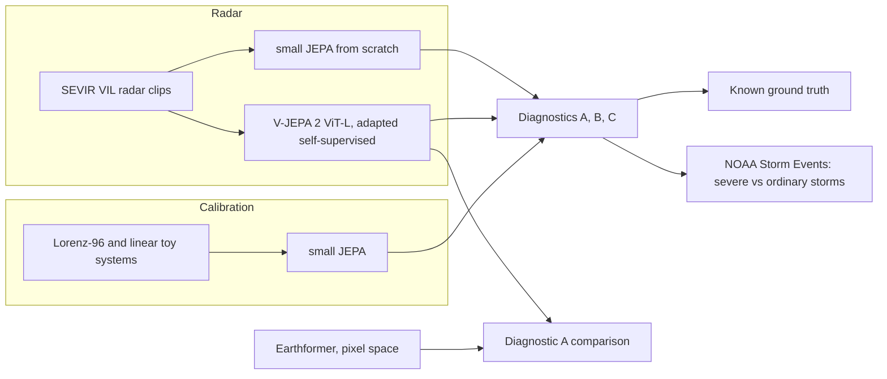

# weather-world-model

[](https://github.com/gabrielkpo/weather-world-model/actions/workflows/ci.yml) [](LICENSE)

Probing what a latent world model has learned about storm dynamics, with dynamical-systems diagnostics instead of forecast scores alone.

> **Status:** step 2 of 5, diagnostics calibrated on simulated systems. See the [roadmap](#status-and-roadmap). Expect breaking changes.

## Why

Latent world models, in the line of JEPA and V-JEPA 2, predict how the world evolves in a space of abstract representations rather than in pixels, and they are starting to reach weather and climate. Most of this work reports forecast quality. A complementary question is what such a model has actually learned about the physics. Linear probes and surprise on physically impossible events are already well studied. This project looks at other properties of the latent dynamics:

- **Predictability**: do nearby latent trajectories diverge the way chaotic weather does? AI weather models are known to reproduce fast initial error growth poorly.
- **Growth and decay modes**: does a linear approximation of the latent dynamics expose modes that match storms intensifying and dissipating?
- **Arrow of time**: does the latent space encode that storm evolution is irreversible?

## How it works



1. **Calibrate.** Each diagnostic is first run on simulated systems with known answers: the leading Lyapunov exponent of Lorenz-96, the eigenvalues of a linear system, a reversible oscillator as negative control.
2. **Adapt.** V-JEPA 2 (MIT) is adapted to SEVIR radar with its own self-supervised objective, without labels. A small JEPA trained from scratch on the same data isolates what pretraining on natural video brings.
3. **Interrogate.** The three diagnostics are applied to the latent predictor and confronted with severe storms reported in NOAA Storm Events, which SEVIR links to its events, and with a pixel-space forecaster (Earthformer).

Technical choices and their trade-offs:

- **A pretrained world model rather than training a large one,** because three weeks on a free GPU cannot match V-JEPA 2's pretraining; the cost is a domain gap (natural RGB video vs one-channel radar), measured by the from-scratch control.
- **Calibration on simulated systems first,** because real weather has no ground-truth Lyapunov exponent; the cost is time spent on toy systems before radar.
- **Linear (DMD) approximation for the modes,** because it is interpretable and cheap; the cost is that strongly nonlinear dynamics may be poorly captured, which the reported one-step R² makes visible.

## Evaluation plan

The full protocol, frozen before any measurement, is in [docs/PROTOCOL.md](docs/PROTOCOL.md). In short:

| Hypothesis | Success criterion |
|---|---|
| Diagnostics recover known answers on calibration systems | Lyapunov exponent within 30 %, eigenvalues within 10 %, arrow-of-time probe > 80 % on Lorenz-96 and < 60 % on a reversible oscillator |
| Severe storms are less predictable in latent space | shorter predictability horizon than ordinary storms, Mann-Whitney p < 0.05 |
| The latent model keeps fast initial error growth | initial growth rate ≥ Earthformer's at equal perturbation |
| A growth mode tracks intensification | Spearman ≥ 0.3 with the VIL growth rate |
| The arrow of time is readable, and pretraining helps | probe > 80 %, and ≥ 5 points above the from-scratch model |

Splits are by date, tuning uses the validation split only, and every number comes from a versioned run record under `results/`. Negative results are reported.

## Results so far

Calibration on simulated systems with known answers (3 seeds, details and caveats in [docs/RESULTS.md](docs/RESULTS.md)):

| Diagnostic | On the true system | On the small JEPA | Verdict |
|---|---|---|---|
| A. Predictability (Lorenz-96 Lyapunov exponent ≈ 1.69) | 1.70 to 1.74 | −0.03 to 0.13 | not supported: the learned latent dynamics do not diverge |
| B. Growth and decay modes (linear map) | exact | moduli within 7.4 %, but the growing mode comes out damped | supported, with a caveat |
| C. Arrow of time (irreversible vs reversible) | 100 % vs 49 to 52 % | 91 to 95 % vs 51 to 52 % | supported |

The diagnostic code recovers the known answers; the small world model keeps the arrow of time but loses chaotic error growth.

## Status and roadmap

| Step | Content | State |
|---|---|---|
| 1 | Repository foundation, protocol | done |
| 2 | Lorenz-96 and linear systems, small JEPA, calibrated diagnostics | done, see [results](docs/RESULTS.md) |
| 3 | SEVIR subset with NOAA Storm Events join, adapted V-JEPA 2, small JEPA from scratch | planned |
| 4 | Diagnostics on radar, Earthformer comparison | planned |
| 5 | Results, report | planned |

## Run it

Requires [uv](https://docs.astral.sh/uv/). The calibration runs on a laptop CPU in about two minutes and downloads nothing beyond the Python dependencies.

```bash
git clone https://github.com/gabrielkpo/weather-world-model.git && cd weather-world-model
uv sync --locked
uv run python -m weather_world_model.calibration.run --profile full --out results/calibration
```

The run writes `results/calibration/calibration-full.json` and prints the verdicts.

## Project structure

| Path | Content |
|---|---|
| `src/weather_world_model/calibration/` | Lorenz-96, linear and reversible oscillators, calibration runner |
| `src/weather_world_model/jepa.py` | small sequence JEPA (encoder, predictor, EMA target, variance-covariance terms) |
| `src/weather_world_model/diagnostics/` | predictability, DMD modes, arrow-of-time probe |
| `docs/` | frozen protocol and results |
| `results/` | versioned run records |

## Related work

- PrecipJEPA (arXiv 2609.38926) uses a JEPA objective to improve radar nowcasting on SEVIR and MeteoNet; M-JEPA (arXiv 2608.22358) studies cross-variable transfer in an atmospheric JEPA. This project uses neither for forecasting: it probes the latent dynamics.
- Selz and Craig (GRL 2023) and arXiv 2609.18489 show that AI weather models reproduce fast initial error growth poorly; diagnostic A asks the same question of a latent world model at storm scale.
- arXiv 2605.15618 reports that V-JEPA 2 encodes the arrow of time on natural video; diagnostic C asks it of radar.
- Garrido et al. (arXiv 2502.11831) evaluate intuitive physics in V-JEPA through surprise; this project uses other diagnostics.

## Limitations

- Not an operational forecasting or warning system, and no image generation.
- The diagnostics measure the dynamics learned by the model, not the atmosphere directly.
- NOAA Storm Events reports depend on population density: unreported severe storms can sit among the ordinary ones.
- SEVIR covers the United States, 2017 onwards, as a subset limited to 50 GB.

## Data

SEVIR (public AWS Open Data bucket), NOAA Storm Events (public, NCEI), V-JEPA 2 weights (MIT), Earthformer weights (Apache-2.0). No data, weights or raw outputs are stored in this repository.

## Development

Requires [uv](https://docs.astral.sh/uv/) (it installs Python 3.12) and `pre-commit`.

```bash
uv sync --locked
uv run ruff check && uv run ruff format --check
uv run mypy
uv run pytest
pre-commit install
```

CI runs the same commands. Pull requests use Conventional Commits titles, go through security and code review, and are squash-merged.

## License

MIT, see [LICENSE](LICENSE). Data and model weights keep their own licences (see [Data](#data)).
