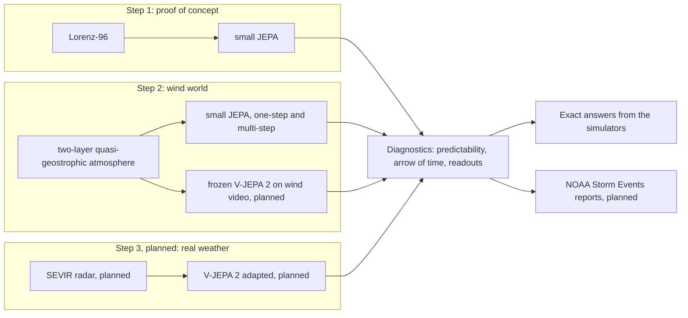

# weather-world-model

[](https://github.com/gabrielkpo/weather-world-model/actions/workflows/ci.yml) [](LICENSE)

Small JEPA world models on Lorenz-96 and a quasi-geostrophic atmosphere, probed for predictability, arrow of time and physical readouts against the simulators' exact answers.

> **Status:** step 1 (Lorenz-96) done. Step 2 (quasi-geostrophic world) measured on a stationary flow, no hypothesis supported, with or without encoder normalisation. Step 3 (SEVIR radar, V-JEPA 2) is planned. See the [roadmap](#status-and-roadmap).

## Why

Latent world models (JEPA, V-JEPA 2) predict in a space of abstract representations rather than pixels, and are starting to reach weather. Most work reports forecast quality; this project asks what such a model has learned about the physics, through three properties of the latent space:

- **Predictability**: do nearby latent trajectories diverge the way chaotic weather does?
- **Arrow of time**: does the latent space encode that atmospheric evolution is irreversible?
- **Physical readouts**: can energy, jet speed or vortex strength be read linearly from the latent?

## How it works



1. **Proof of concept.** The diagnostics are run on Lorenz-96, whose Lyapunov exponent is known, to check they recover known answers.
2. **Wind world.** A two-layer quasi-geostrophic atmosphere (a baroclinic jet with vortices) gives a 2D world with known physics. Small JEPAs are trained on it with a one-step, a multi-step or a stochastic latent loss, and their latents are read against the simulator's exact energy, jet speed and vortices. A frozen V-JEPA 2 measurement is prepared (adapter and Kaggle notebook) but not run.
3. **Real weather (planned).** V-JEPA 2 adapted to SEVIR radar videos, with the diagnostics confronted with severe storms reported in NOAA Storm Events.

### The model and how it is examined

<p align="center">
  
</p>

The encoder compresses a wind map into a latent `z` of 32 numbers and the predictor advances `z` one step (the figure shows the stochastic variant). After training, a linear probe on the frozen model reads a physical quantity from `z` and is scored (R²) against the simulator's exact value.

Technical choices and their trade-offs:

- **A pretrained world model rather than training a large one,** because the compute available cannot match V-JEPA 2's pretraining; the cost is a domain gap (natural video vs physical fields).
- **Simulated worlds before real data,** because real weather has no exact Lyapunov exponent or energy; the cost is time before the radar.
- **Linear readouts,** because they show what the latent makes explicit; the cost is missing nonlinear information.

## Example

A smoke run of the calibration (seconds on a CPU, sizes too small for meaning):

```bash
uv run python -m weather_world_model.calibration.run --profile smoke --out /tmp/x
```

It writes `/tmp/x/calibration-smoke.json`, whose `verdicts` include:

```json
"H0-C": {
  "lorenz96_accuracy": {"mean": 0.875, "min": 0.875, "max": 0.875},
  "harmonic_accuracy": {"mean": 0.4166666666666667, "min": 0.4166666666666667, "max": 0.4166666666666667},
  "supported": true
}
```

## Results

Criteria are fixed in advance in [docs/PROTOCOL.md](docs/PROTOCOL.md) and changed only by dated amendments. Ranges are min to max over 3 seeds; caveats in [docs/RESULTS.md](docs/RESULTS.md).

**Step 1, Lorenz-96** (`results/calibration/calibration-full.json`):

| Diagnostic | On the true system | On the small JEPA | Verdict |
|---|---|---|---|
| A. Predictability (Lyapunov exponent ≈ 1.69) | 1.70 to 1.74 | −0.03 to 0.13 | not supported |
| B. Modes of a linear map | exact | moduli within 7.4 %, growing mode damped | supported, with a caveat |
| C. Arrow of time (irreversible vs reversible) | 100 % vs 49 to 52 % | 91 to 95 % vs 51 to 52 % | supported |

The diagnostics recover known answers; the small JEPA keeps the arrow of time, not chaotic error growth. Diagnostic B was withdrawn afterwards (amendment 2).

**Step 2, quasi-geostrophic world on a stationary flow** (`results/qg/qg-stationary.json`, encoder with GroupNorm; k = 1 and k = 8 are the one-step and 8-step losses):

| Hypothesis (measure) | Reference | Small JEPA | Verdict |
|---|---|---|---|
| W-A, error growth rate (ε = 1e-3) | truth 0.96 | k = 1: 0.08 to 0.32; k = 8: −0.07 to −0.01 | not supported |
| W-C, arrow-of-time probe, plain (mirrored control) | true fields 88.6 % (49.2 %) | k = 1: 68.9 to 86.4 % (53.8 to 57.6 %); k = 8: 78.8 to 89.4 % (47.7 to 60.6 %) | not supported |
| W-P, test R² of kinetic energy / jet speed | random weights −0.03 to 0.08 / −0.03 to 0.11 | k = 1: −0.03 to 0.05 / 0.23 to 0.32 | not supported |
| W-R, R² gain over persistence at h = 10, per seed | 0.05 required | k = 1: −0.47, −0.27, −0.13; k = 8: −0.033, 0.021, −0.044 | not supported |
| W-S, stochastic model's sensitivity rate | truth 0.96 | 0.023 to 0.041 | not supported |

Exploratory, not protocol results:

- The arrow-of-time probe reads the direction of wave propagation, not irreversibility: it is at chance once the reversed clip is mirrored.
- GroupNorm in the encoder erases the field amplitude: a random encoder reads kinetic energy at R² −0.03 to −0.02 with it, 0.70 to 0.83 without it. The rerun without normalisation (amendment 6) supports no hypothesis either: trained encoders read kinetic energy at R² 0.20 to 0.66, below the random encoder, and the stochastic model collapses.

## Status and roadmap

| Step | Content | State |
|---|---|---|
| 1 | Lorenz-96 proof of concept | done |
| 2 | QG wind world, small JEPAs | done on a stationary flow, with GroupNorm and without normalisation (amendment 6); no hypothesis supported |
| 2b | Frozen V-JEPA 2 on the QG world (W-V) | prepared (adapter, Kaggle notebook), not run |
| 3 | SEVIR radar, NOAA Storm Events, adapted V-JEPA 2 | planned |

## Run it

Requires [uv](https://docs.astral.sh/uv/). About two minutes on a laptop CPU; downloads only Python dependencies.

```bash
git clone https://github.com/gabrielkpo/weather-world-model.git && cd weather-world-model
uv sync --locked
uv run python -m weather_world_model.calibration.run --profile full --out results/calibration
```

It writes `results/calibration/calibration-full.json` and prints the verdicts.

## Project structure

| Path | Content |
|---|---|
| `src/weather_world_model/calibration/` | Lorenz-96, linear and reversible oscillators, calibration runner |
| `src/weather_world_model/jepa.py` | small JEPA (encoder, predictor, EMA target) |
| `src/weather_world_model/diagnostics/` | predictability, DMD modes, arrow of time, `readouts.py` (linear probes) |
| `src/weather_world_model/worlds/` | two-layer QG world (`qg.py`), step-2 runner (`run_qg.py`), V-JEPA 2 adapter (`vjepa2_qg.py`) |
| `scripts/` | exploratory analyses, demo export, Kaggle wheel build |
| `tests/` | test suite |
| `notebooks/` | Kaggle notebook for V-JEPA 2, see [docs/KAGGLE.md](docs/KAGGLE.md) |
| `docs/` | frozen protocol and results |
| `results/` | versioned run records |

## Data

Steps 1 and 2 simulate their data locally. The Kaggle notebook fetches V-JEPA 2 weights (MIT) from Hugging Face. No data, weights or raw outputs are stored in this repository.

### Planned (step 3)

SEVIR (public AWS Open Data bucket), NOAA Storm Events (public, NCEI), Earthformer weights (Apache-2.0).

## Limitations

- Not a forecast system.
- The diagnostics measure the dynamics learned by the model, not the atmosphere directly.
- Three seeds per model; uncertainty is the range over seeds, not a confidence interval.

### Planned (step 3)

- NOAA Storm Events reports depend on population density: unreported severe storms can sit among the ordinary ones.
- SEVIR covers the United States, 2017 onwards, as a subset limited to 50 GB.

## Related work

- PrecipJEPA (arXiv 2609.38926) uses a JEPA objective as a regulariser for radar nowcasting on SEVIR and MeteoNet; M-JEPA (arXiv 2608.22358) studies cross-variable transfer in an atmospheric JEPA. This project probes latent dynamics instead of forecasting.
- Selz and Craig (GRL 2023) and arXiv 2609.18489 show that AI weather models reproduce fast initial error growth poorly; diagnostic A asks this of a latent world model.
- arXiv 2605.15618 reports that latent-prediction video models, V-JEPA 2 among them, encode the arrow of time; diagnostic C asks it of a world model of the atmosphere.

## Development

Requires [uv](https://docs.astral.sh/uv/) (it installs Python 3.12) and `pre-commit`.

```bash
uv sync --locked
uv run ruff check && uv run ruff format --check
uv run mypy
uv run pytest
pre-commit install
```

CI runs the same commands. Pull requests use Conventional Commits titles and are squash-merged.

## License

MIT, see [LICENSE](LICENSE). Data and weights keep their own licences.
